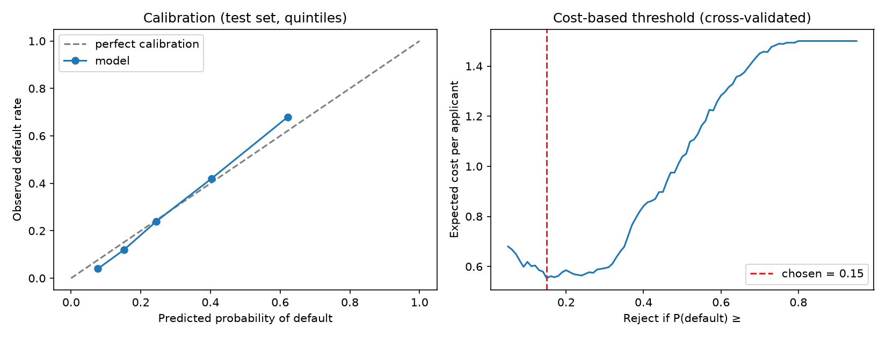

# Data science projects

[](https://github.com/quizdany/data-science-portifolio/actions/workflows/ci.yml)

## 1. Credit default risk model

Predicts the probability that a loan applicant defaults and decides approve / refer based on the cost of each type of error.

- Data checks before training
- Logistic regression vs gradient boosting (5-fold CV)
- Calibrated probabilities (Platt scaling)
- Threshold chosen by cost (a missed default costs 5x a wrong rejection), tuned on CV scores
- Fairness check: sex, age and foreign-worker status are left out of the model and only used to compare outcomes
- Drift monitoring with PSI

Test set (250 applicants): ROC-AUC 0.81, Gini 0.63, KS 0.53. Cost per applicant drops from 0.90 (cut-off 0.5) to 0.50 (cost-based cut-off).



More detail in the [model card](docs/credit_risk/model_card.md).

```bash
pip install -e ".[dev]"
python -m credit_risk train      # downloads data, writes reports to artifacts/credit_risk/
make credit-score                # scores an example applicant
```

Data: German Credit (1,000 applicants), from [selva86/datasets](https://github.com/selva86/datasets).

## 2. Penguin species classifier

Classification pipeline on the Palmer Penguins data: preprocessing, grid search over a random forest, macro F1, confusion matrix, feature importance, saved model and a CLI. See the [model card](docs/model_card.md).

```bash
python -m penguin_classifier train
make predict
```

## Tests

```bash
pytest
```

The tests run offline (fake applicant data for the credit model).

## Layout

```text
src/credit_risk/          data checks, models, fairness/drift, CLI
src/penguin_classifier/
docs/credit_risk/         model card and saved results
tests/
```
