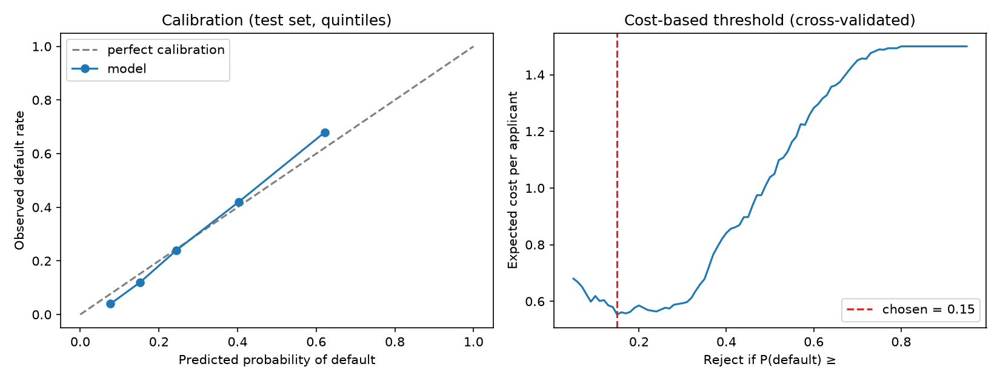

# Model card – credit default model

## Purpose

Estimates the probability that a loan applicant defaults and turns it into an approve / refer decision. Portfolio project, not a production model.

## Data

- German Credit data: 1,000 applicants, 300 defaults
- Target: `default` = 1 when the credit is labelled bad
- 75/25 train/test split, stratified. Model choice, calibration and threshold use cross-validation on the training set only
- The loader checks columns, missing values and value ranges before training

## Features

17 inputs: account status, credit history, purpose, amount, duration, savings, employment, property, housing, job, etc.

Sex/marital status, age and foreign-worker status are **not** used as features. They're only used in the fairness check.

## Model comparison (5-fold CV on train)

| Model | ROC-AUC | Gini | KS | PR-AUC | Brier |
| --- | --- | --- | --- | --- | --- |
| Gradient boosting | 0.780 | 0.559 | 0.434 | 0.590 | 0.167 |
| Logistic regression | 0.766 | 0.531 | 0.410 | 0.584 | 0.172 |

Rule: keep logistic regression unless boosting is better by at least 0.01 AUC. Boosting was, so it was used, with sigmoid (Platt) calibration.

## Test results (250 applicants)

| Metric | Value |
| --- | --- |
| ROC-AUC | 0.814 |
| Gini | 0.627 |
| KS | 0.530 |
| Brier | 0.155 |

Calibration is close: e.g. 0.40 predicted vs 0.42 observed in the 4th quintile.

## Threshold

The dataset's cost matrix: approving someone who defaults costs 5, rejecting someone who would repay costs 1. The cost-minimising threshold on CV scores is **0.15** (refer/decline if P(default) ≥ 0.15).

| Policy (test set) | Cost per applicant |
| --- | --- |
| Approve everyone | 1.50 |
| Cut-off 0.5 | 0.90 |
| Cut-off 0.15 | 0.50 |

At 0.15 only about 32% are approved outright. In practice the middle band would go to manual review.

## Fairness (test set)

See `fairness_audit.csv`.

- Sex: similar approval rates (31% female, 32% male) and error rates.
- Age: under-25s are approved less (23% vs 34%), but they also default more in this data (52% vs 25%). Worth monitoring since age can be protected.
- Foreign worker: only 8 non-foreign workers in the test set – too few to say anything.

## Monitoring

PSI on scores and inputs (<0.10 stable, 0.10–0.25 monitor, >0.25 investigate). Train vs test score PSI is 0.04; all numeric features are stable.

## Limitations

- Small, old dataset (1990s Germany) – results don't transfer to other markets.
- The cost matrix comes from the dataset, not a real lender.
- No per-applicant reason codes yet (coefficients or SHAP would be next).
